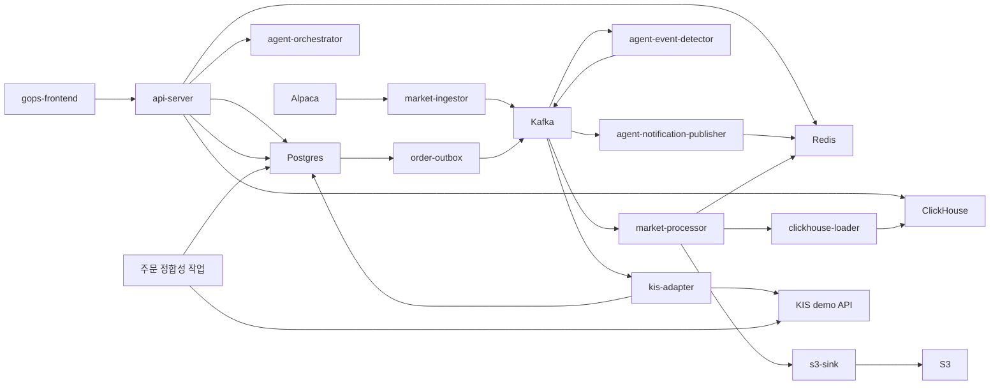

# GOPS

미국 주식 시장 데이터 조회, 차트, 모의 주문 및 AI 분석 기능을 구현한 크래프톤 정글 팀 프로젝트입니다.
이 저장소는 팀의 공개 허용을 받아 정범진([iamnuked](https://github.com/iamnuked))의
취업 포트폴리오용으로 정리한 독립 복사본입니다.

> **현재 서비스 중단 · 실행 안내**
> 외부 API 이용 기한과 웹사이트 운영 기한이 만료되어, 기존 배포 사이트 및 외부 연동 기능을
> 현재 정상 실행할 수 없습니다. 이 저장소는 구현 내용과 설계·커밋 이력을 검토하기 위한 자료입니다.
> 아래 기술·아키텍처·API 설명은 저장된 코드와 과거 구현을 설명하며, 현재 운영 중임을 의미하지 않습니다.

## 프로젝트 출처와 기여

- 원본: [KFJG-Team1/gops](https://github.com/KFJG-Team1/gops) — 팀 비공개 저장소이므로 접근 권한이 필요합니다.
- 복사 기준: 원본 `main` 커밋 `9e12e98eb38d48ac6ba87fef539190d29c989c2b`.
- 해당 커밋에서 이어지는 1,102개 커밋과 작성자·공동 작업 이력을 보존했습니다.
  별도 개발 브랜치와 태그, GitHub 이슈·PR·리뷰·저장소 비밀값은 복사하지 않았습니다.
- 정범진의 담당 경험: AWS EKS 기반 인프라 구축·운영, 빌드·배포 환경 구성,
  캐시 중복 계산 및 실시간 데이터 전달 구조 개선.
- 전체 코드는 팀 공동 결과물입니다. 이 개인 저장소의 소유자가 프로젝트 전체를 단독 구현했다는 의미는 아닙니다.

현재 에이전트의 방향과 책임 경계는 `docs/AGENT_ARCHITECTURE.md`에서 확인할 수 있다.
미래 제품 아이디어는 방향을 설명하는 참고 사항이며, 이미 구현된 기능을 보장하지 않는다.

## 현재 범위

이 저장소에는 현재 다음 구성 요소가 포함되어 있다.

- React 프론트엔드와 공용 차트 엔진
- FastAPI 기반 차트·주문·WebSocket API 서버
- Alpaca 시장 데이터 수집과 필요 시 실행하는 과거 데이터 보충
- Kafka 호환 스트림 처리
- Redis, ClickHouse, S3 기반 시장 데이터 조회·저장
- KIS 모의투자 주문 API, PostgreSQL 영속화, Outbox, 브로커 어댑터, 마이그레이션, 정합성 확인
- 역할별 에이전트 골격, 시장 이벤트 감지, 알림 발행을 포함한 에이전트 오케스트레이션 v1
- 로컬 Docker Compose와 AWS/EKS 배포 구성

## 기술 스택

| 영역 | 기술 | 프로젝트에서의 역할 |
| --- | --- | --- |
| 프론트엔드 | React 19, TypeScript, Vite | 시장 데이터·주문·AI 분석 화면 구현과 프론트엔드 빌드 |
| 차트 | 자체 TypeScript 차트 엔진, Canvas 2D, D3 | 캔들·지표·작도 상태 관리, 좌표 계산과 차트 렌더링 |
| 백엔드 | Python 3.12, FastAPI, Uvicorn | 차트·주문·분석 REST API와 실시간 연결 처리 |
| 실시간 통신 | WebSocket, Server-Sent Events(SSE), Redis Pub/Sub | 시세·주문·알림 전달과 분석 리포트 진행 상황 스트리밍 |
| 이벤트 스트림 | Apache Kafka | 시장 데이터와 주문·분석 이벤트를 수집기 및 작업자 사이에서 비동기로 전달 |
| 데이터 저장 | PostgreSQL 16, ClickHouse 24.12, Redis 7, Amazon S3 | 주문 상태 영속화, 과거 시계열 조회, 최신 데이터·세션·캐시, 재생·재구성용 데이터 보관 |
| AI 분석 | LangGraph, OpenAI API, Ontotext GraphDB | 역할별 분석 흐름 조율, 자연어 응답 생성, 기업·시장 관계 데이터 조회 |
| 외부 연동 | Alpaca API, KIS 모의투자 API, Google OAuth 2.0, Logo.dev | 시장 데이터 수집, 모의 주문, 로그인, 기업 로고 표시 |
| 컨테이너·배포 | Docker, Docker Compose, Kubernetes, Kustomize | 로컬 서비스 실행, 컨테이너 배포와 환경별 설정 조합 |
| AWS 인프라 | EKS Auto Mode, ECR, S3, ALB, ACM, IAM/IRSA, Secrets Manager | 컨테이너 실행·이미지 저장·HTTPS 진입점·워크로드 권한·비밀값 관리 |
| 인프라 코드 | Terraform | ECR·S3·Secrets Manager·IRSA 기반 리소스 구성 |
| 검증·배포 자동화 | pytest, 프론트엔드 테스트 스크립트, Playwright, GitHub Actions | Python·차트 테스트, 브라우저 테스트, 빌드 검증과 수동 실행형 EKS 배포 워크플로 |

버전은 저장소의 의존성 선언 및 컨테이너 이미지 기준이다. 로컬 S3 호환 저장소로는
MinIO를 사용한다. 원본의 GitHub Actions 배포는 `workflow_dispatch` 수동 실행 방식이며,
[로컬 EKS 배포 스크립트](docs/LOCAL_EKS_DEPLOY.md)도 보존했다.
이 포트폴리오 저장소에서는 GitHub Actions를 비활성화하고 운영 자격 증명을 제공하지 않는다.

## AWS 아키텍처


AWS 네트워크와 애플리케이션·데이터 계층의 관계를 보여주는 구성도다.
React 프론트엔드, FastAPI 백엔드, 시장 데이터 수집·처리 작업자, AI 에이전트와
주문 작업자를 EKS 워크로드로 분리한다.

- **사용자 요청:** ALB가 HTTPS 요청을 프론트엔드와 백엔드 Service로 라우팅한다.
  `/api`와 `/ws` 경로는 백엔드로 전달하며, ACM 인증서로 HTTPS를 구성한다.
- **시장 데이터:** Alpaca 수집기가 Kafka로 이벤트를 전달하고, 처리 작업자가
  Redis의 최신 데이터를 갱신한다. 저장 작업자는 ClickHouse 조회 데이터와 S3 보관
  데이터를 기록한다. 차트 API는 Redis·ClickHouse에서 조회하고 WebSocket으로 갱신을 전달한다.
- **모의 주문:** API가 PostgreSQL에 주문과 Outbox 이벤트를 저장하고,
  발행 작업자가 Kafka로 전달한다. KIS 어댑터가 모의투자 API와 연동하며,
  별도 정합성 확인 작업이 주문 상태를 점검한다.
- **AI 분석:** 백엔드가 에이전트 오케스트레이터에 분석을 요청하고, 역할별 분석 흐름에서
  시장·기업 데이터와 GraphDB 관계 정보를 사용한다. 설정된 경로에서 OpenAI API로
  응답을 생성하며, 분석 리포트는 폴링·SSE로 전달한다.
- **권한·배포:** ECR에 서비스별 이미지를 보관하고 Secrets Manager로 비밀값을 관리한다.
  저장소에는 IRSA 서비스 계정과 AWS 권한 구성이 포함되어 있다.

그림의 양쪽 가용 영역 배치는 모든 서비스의 이중화 완료를 의미하지 않는다.
현재 저장소의 Kafka·Redis·PostgreSQL·ClickHouse·GraphDB StatefulSet은 각각
`replicas: 1`이며, 그림에 표시된 EKS Pod Identity의 실제 적용 여부는 별도 확인이 필요하다.
또한 이 저장소의 Terraform은 EKS 클러스터·VPC·서브넷·NAT를 생성하지 않고 기존 인프라를
전제로 한다. 세부 범위는 [Terraform 안내](infra/aws/terraform/README.md),
워크로드 구성은 [플랫폼 매니페스트](infra/k8s/base/platform)와
[GraphDB 매니페스트](infra/k8s/base/app/statefulset-graphdb.yaml)를 참고한다.

## 먼저 읽을 문서

| 파일 | 용도 |
| --- | --- |
| `docs/README.md` | 에이전트 인수인계 문서 색인 |
| `docs/AGENT_ARCHITECTURE.md` | 에이전트 런타임, 제공자 경계, 스냅샷, 종합 분석, 리포트 계약 |
| `docs/AGENT_BACKEND_INTEGRATION.md` | 에이전트 API, 멱등성, Kafka 비동기 처리, Redis 리포트 저장소, 폴링, SSE, 알림 WebSocket 계약 |
| `docs/AGENT_FRONTEND_INTEGRATION.md` | 에이전트 채팅 제출, `analysisId`, 리포트 표시, 레이아웃·차트 제안 처리 |
| `docs/AGENT_AWS_BUILD.md` | 에이전트 이미지, EKS 리소스, Kafka, Redis/Valkey, ClickHouse, GraphDB, S3, 비밀값, 스모크 검사 |
| `AGENTS.md` | Codex와 이후 기여자가 따라야 할 규칙 |

## 저장소 구조

```text
apps/gops-frontend/                React 프론트엔드
apps/chart-engine/                 차트 문서·런타임·캔버스 엔진

systems/api-server/                FastAPI 차트·주문·WebSocket 게이트웨이
systems/market-data/               설정, 수집, 처리, 저장, 조회 도우미, 필요 시 데이터 보충
systems/order/                     KIS 모의투자 주문 도메인, Outbox, 어댑터, 작업
systems/agent-orchestration/       역할별 에이전트, 이벤트 감지기, 알림 발행기

platform/kafka/topics.txt          시장·주문 Kafka 토픽 계약
platform/*/README.md               로컬 -> Pod -> 관리형 서비스 전환 설명

infra/docker/                      Dockerfile 모음
infra/k8s/                         Kubernetes 기본 구성과 AWS 오버레이
infra/aws/terraform/               ECR·S3·Secrets·IRSA 기반 구성
infra/clickhouse/initdb/           로컬 ClickHouse 스키마

scripts/local/                     로컬 스모크 검사·점검 스크립트
scripts/aws/                       AWS 이미지·토픽·적용 도우미
shared/chart-contract/             시스템 간 차트 명령 계약 설명
docs/                              프로젝트 참고 문서
```

## 런타임 흐름



## 현재 실행 가능 범위

| 항목 | 현재 상태 |
| --- | --- |
| 기존 웹사이트 | 운영 기한 만료로 이용 불가 |
| Alpaca·KIS·OpenAI 등 외부 연동 | 기존 이용 환경으로 정상 실행 불가. 재구성 시 별도 계정·권한·유효한 자격 증명 필요 |
| AWS 배포 환경 | 현재 사용 가능한 환경으로 제공하지 않음. 인프라 파일은 설계·구현 참고용 |
| 로컬 Docker Compose | 구성 파일 보존. 컨테이너 기동만으로 과거 데이터·외부 연동까지 복구되지는 않음 |
| 과거 데이터 재생 | 비공개 이동식 백업이 필요하며, 해당 데이터는 이 공개 저장소에 포함하지 않음 |
| 테스트·빌드 | 코드와 검사 명령 보존. 이번 공개 복사 과정에서는 서비스 실행·외부 API 호출·AWS 배포를 수행하지 않음 |

코드 검토는 [기술 스택](#기술-스택), [AWS 아키텍처](#aws-아키텍처),
[저장소 구조](#저장소-구조), [런타임 흐름](#런타임-흐름) 순으로 살펴볼 수 있습니다.
과거의 상세 실행·백업 복원 절차는 [로컬 실행 참고 자료](docs/LOCAL_RUNTIME_REFERENCE.md)에
보관했습니다. 외부 서비스 재가입·재결제·재배포는 이 공개 복사 작업에 포함하지 않습니다.

## API 계약

차트 API:

```text
GET  /api/charts/candles
GET  /api/charts/symbols
WS   /ws/charts
```

사용 중단된 차트 백필 큐 경로는 `410 Gone`을 반환한다. `GET /api/charts/candles`는
차트를 조회하고 누락 데이터를 보충하는 단일 진입점이며, 데이터가 없거나 일부만 채워진
경우 응답에 `fill` 추적 정보를 포함한다.

에이전트 API:

```text
POST /api/agents/analyze
GET  /api/agents/reports/{analysis_id}
GET  /api/agents/reports/{analysis_id}/stream
WS   /ws/agent-alerts
```

주문 API:

```text
GET  /api/order-contract
GET  /api/orders/balance
POST /api/orders
GET  /api/orders/{order_id}
GET  /api/orders/{order_id}/events
WS   /ws/orders/{order_id}
```

주문 규칙:

- `POST /api/orders`는 `Idempotency-Key` 헤더가 반드시 필요하다.
- `GET /api/orders/balance`는 선택한 종목과 거래소를 기준으로 KIS 모의투자 해외주식 주문 가능 금액을 조회한다.
- v1에서는 `KIS_ENV=real`을 사용할 수 없다.
- v1 주문 제출은 KIS 해외주식 모의투자 지정가 주문만 지원한다.
- KIS 모의투자 자격 증명은 기본적으로 AWS Secrets Manager의 `tead/gops/kis`에서 읽는다.

인증 규칙:

- `AUTH_ENABLED=true`로 설정하면 `/api/orders`, `/ws/orders/{order_id}`, `/api/llm/*`에서 Google 로그인을 요구한다.
- v1에서 차트와 시장 데이터 API는 공개 상태를 유지한다.
- 세션은 Redis에 저장되며 `AUTH_REDIS_KEY_PREFIX`로 범위를 분리한다.
- Google OAuth 환경 변수를 먼저 직접 읽고, 값이 비어 있으면 `GOOGLE_OAUTH_SECRET_NAME`에 지정한 AWS Secrets Manager 비밀값에서 읽는다.

## 운영 규칙

- 차트 API는 S3를 직접 읽지 않고 Redis와 ClickHouse에서 응답한다.
- S3는 재생과 재구성을 위한 영구 저장소다.
- ClickHouse의 `chart_candles`가 조회용 프로젝션이다.
- 로컬 런타임은 가짜 시장 캔들을 만들면 안 된다.
- 에이전트 오케스트레이션은 주문을 실행하거나 계좌 제어 흐름을 호출하면 안 된다.
- 에이전트 제공자 호출이 실패하면 전체 분석을 중단하지 않고 데이터 없음 근거로 안전하게 축소해야 한다.
- `.env`, 액세스 키 CSV, KIS 토큰 캐시, `node_modules`, `dist`, 로컬 캐시는 커밋하면 안 된다.

## 검증

변경 사항을 공유하기 전에 관련 검사를 실행한다.

```sh
PYTHONPATH=systems/market-data/shared:systems/order/shared:systems/order:systems/api-server/pods/api-server/gops-backend python -m compileall -q systems
PYTHONPATH=systems/market-data/shared:systems/order/shared:systems/order:systems/api-server/pods/api-server/gops-backend python -m unittest discover systems/market-data/tests
PYTHONPATH=systems/market-data/shared:systems/order/shared:systems/order:systems/api-server/pods/api-server/gops-backend python -m unittest discover systems/api-server/tests
PYTHONPATH=systems/market-data/shared:systems/order/shared:systems/order:systems/api-server/pods/api-server/gops-backend python -m pytest systems/order/tests/kis_trader
npm run test:chart --prefix apps/gops-frontend
npm run build --prefix apps/gops-frontend
docker compose config --quiet
kubectl kustomize infra/k8s/base >/tmp/gops-k8s-base.yaml
kubectl kustomize infra/k8s/overlays/aws >/tmp/gops-k8s-aws.yaml
git diff --check
```

실행 중인 서비스의 스모크 검사:

```sh
curl -fsS http://localhost:8000/health
curl -fsS http://localhost:8000/api/charts/symbols
curl -fsS 'http://localhost:8000/api/charts/candles?symbol=NVDA&interval=1m&limit=2'
curl -fsS http://localhost:8000/api/order-contract
curl -fsS 'http://localhost:8000/api/orders/balance?symbol=NVDA&exchange=NASD&price=1.00'
```
