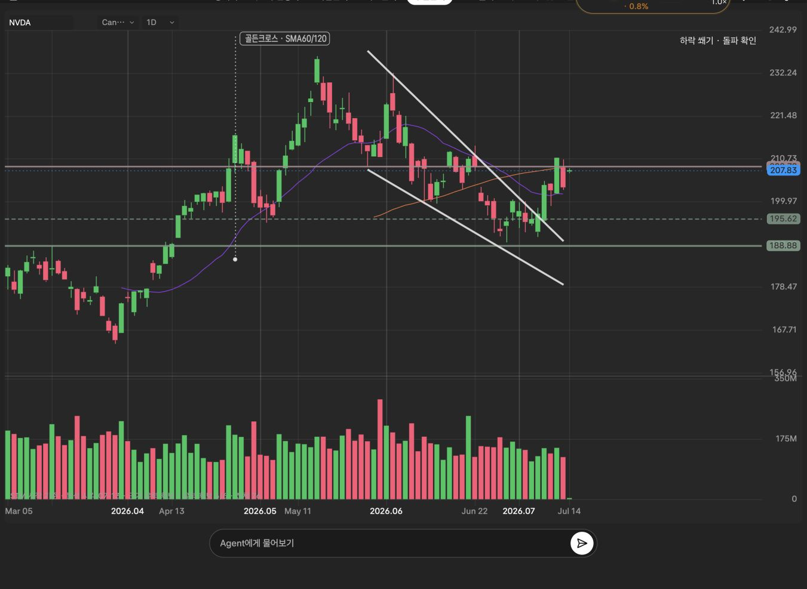
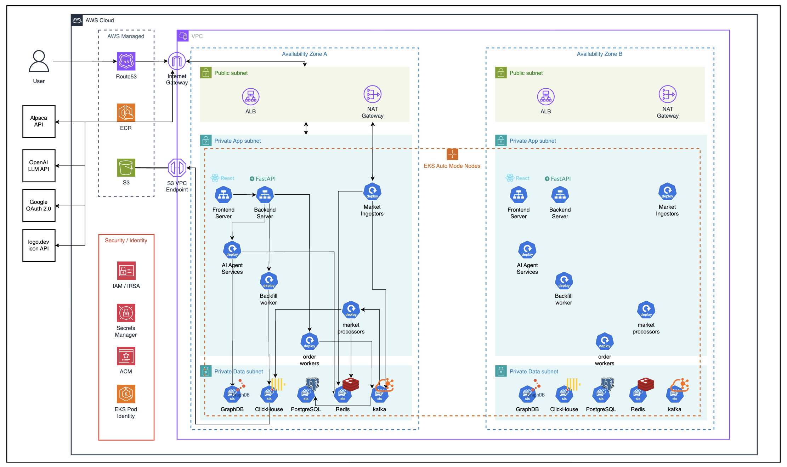

# GOPS

### 실제 미국 주식 차트에 패턴과 분석 근거를 표시하는 투자 플랫폼

**정범진 · 클라우드 인프라 / 배포 / 데이터 처리 구조 개선**

GOPS는 **실제 미국 주식 차트 위에 패턴·추세·지지·저항을 표시하고, 분석 근거를 확인할 수 있는 투자 플랫폼**입니다. Alpaca에서 수집한 실제 시장 데이터를 바탕으로 차트 분석과 AI 해설, 모의투자를 연결합니다.
크래프톤 정글 팀 프로젝트로 개발했으며, 저는 **AWS 실행 환경과 배포 흐름을 구성하고, 동시 요청과 실시간 데이터 전달에서 발생하는 반복 작업을 줄이는 역할**을 맡았습니다.

[주요 기여](#주요-기여) · [문제 해결](#문제-해결) · [아키텍처](#아키텍처) · [코드와 문서](#코드와-문서)

*실제 시장 데이터와 백업에 저장된 작도 자산을 복원한 NVDA 일봉 화면입니다. 하락 쐐기 패턴과 돌파 상태, 추세선, 지지·저항선을 함께 표시합니다. 2026년 7월 시장 기록을 재생하는 화면으로, 현재 실시간 시세가 아닙니다.*

> 실제 시장 데이터를 활용해 개발·시연했으며, 주문은 KIS 모의투자 환경에서 처리했습니다. 현재는 외부 API 이용 및 웹사이트 운영 기한이 만료되어 기존 배포 서비스를 이용할 수 없습니다.

## 프로젝트 소개

핵심 경험은 **차트에 표시된 패턴과 가격 구간을 보며 분석 근거를 확인하는 것**입니다. 패턴·추세·지지·저항 레이어를 선택해 살펴보고, 차트 해설과 기업 정보·모의 주문으로 이어갈 수 있도록 만들었습니다.

| 기능 | 사용자 경험 |
| --- | --- |
| 패턴·작도 분석 | 실제 캔들 차트 위에 패턴·추세선·지지·저항선을 표시하고 레이어별로 확인합니다. |
| 실시간 차트 | 미국 주식의 캔들·체결·호가 흐름과 거래량·지표를 확인합니다. |
| AI 분석 | 시장·기업 데이터를 바탕으로 분석 리포트와 차트 해설을 확인합니다. |
| 종목 탐색 | 시장 현황과 추천 종목, 기업 정보를 살펴봅니다. |
| 모의투자 | 한국투자증권(KIS) 모의투자 API를 통해 주문과 계좌 상태를 확인합니다. |

위 기능은 **팀 전체의 결과물**입니다. 아래에는 제 담당 범위와 관련 구현을 정리했습니다.

## 주요 기여

| 담당 영역 | 수행 내용 | 확인 자료 |
| --- | --- | --- |
| AWS 인프라 | EKS 기반 서비스 실행 환경 구축·운영, 애플리케이션과 데이터 계층 배포 구성 | [Kubernetes 구성](infra/k8s), [AWS 리소스 구성](infra/aws/terraform) |
| 빌드·배포 | GitHub Actions 기반 빌드·배포 환경 구성, 서비스별 이미지와 배포 흐름 정리 | [배포 워크플로](.github/workflows/deploy-dev.yml), [로컬 EKS 배포 문서](docs/LOCAL_EKS_DEPLOY.md) |
| 동시 요청 처리 | 같은 요청의 진행 중 계산을 공유하고 Redis 분산 잠금으로 서버 간 중복 계산 완화 | [계산 서비스](systems/api-server/pods/api-server/gops-backend/app/market_data/derived/service.py) |
| 실시간 데이터 전달 | 사용자별 반복 조회를 공통 이벤트 구독과 연결별 전달 구조로 개선 | [실시간 스트림 허브](systems/api-server/pods/api-server/gops-backend/app/market_data/realtime/stream_hub.py) |

## 문제 해결

### 1. 같은 분석 요청이 몰릴 때 반복되는 계산 줄이기

**문제** — 캐시에 결과가 없는 순간 같은 요청이 동시에 들어오면, 각 요청이 동일한 데이터를 조회하고 계산을 반복할 수 있습니다. 서버가 여러 개라면 한 서버 안에서만 요청을 묶는 것으로는 부족합니다.

**해결** — 계산 결과의 재사용과 진행 중 작업의 공유를 함께 적용했습니다.

- 결과가 캐시에 있으면 저장된 결과를 반환합니다.
- 같은 서버 프로세스에서는 동일 요청의 진행 중 계산을 공유합니다. 이처럼 같은 작업을 하나로 묶는 방식을 **singleflight**라고 합니다.
- 서버 프로세스 사이에서는 Redis를 이용한 **분산 잠금**으로 계산 주체를 조율하고, 다른 요청은 캐시 결과를 기다립니다. Redis는 여러 서버가 공유하는 메모리 기반 저장소입니다.
- 잠금을 해제할 때 소유자를 확인해, 만료된 작업이 다른 작업의 새 잠금을 지우지 않도록 합니다.

**결과와 판단** — 캐시가 비어 있는 시점의 중복 계산을 완화하는 구조를 만들었습니다. 다만 대기 시간이 지나면 직접 계산하는 경로가 있으므로, 모든 상황에서 계산이 한 번만 실행되는 구조는 아닙니다.

[구현 코드](systems/api-server/pods/api-server/gops-backend/app/market_data/derived/service.py) · [잠금 만료·소유권 검증 테스트](systems/api-server/tests/test_market_data_singleflight.py)

### 2. 접속자마다 같은 시세를 반복 조회하는 구조 개선

**문제** — 같은 종목을 보는 사용자가 늘 때 각 연결이 같은 데이터를 반복 조회하면, 사용자 수에 따라 저장소 조회와 데이터 가공이 중복될 수 있습니다.

**해결** — 서버 프로세스가 공통 시장 이벤트 채널을 구독하고, 종목별로 등록된 사용자 연결에 이벤트를 나누어 전달하도록 구성했습니다. Redis의 **Pub/Sub**는 발행자가 채널에 보낸 메시지를 구독자에게 전달하는 기능으로, 여기서는 시장 이벤트를 API 서버에 전달합니다.

- 연결 직후에는 현재 상태를 전달하고 이후 변경 사항을 이벤트로 받습니다.
- 동일 종목의 이벤트를 해당 종목을 구독한 연결에 전달합니다.
- 연결별 대기열에 크기 제한을 두어 느린 클라이언트가 이벤트를 무한히 쌓지 않게 합니다.
- 누락된 이벤트를 보완하기 위한 주기적 복구 조회를 함께 유지합니다.

**결과와 판단** — 실시간 변경 전달의 중심을 사용자별 반복 조회에서 공통 구독으로 옮겼습니다. 초기 상태 조회와 복구 조회는 유지해 이벤트 전달과 상태 복구를 함께 고려했습니다.

[구현 코드](systems/api-server/pods/api-server/gops-backend/app/market_data/realtime/stream_hub.py) · [실시간 처리 테스트](systems/api-server/tests/test_market_data_realtime.py)

### 3. 여러 서비스를 배포할 때 변경 범위와 성공 상태 관리

**문제** — 프론트엔드·API·데이터 작업자가 함께 있는 저장소에서는 작은 변경에도 전체 이미지를 다시 빌드하거나, 일부 서비스의 배포 성공을 전체 배포 성공으로 취급하기 쉽습니다.

**해결** — GitHub Actions로 빌드·배포 환경을 구성하고, 서비스별 컨테이너 이미지와 Kubernetes 배포 구성을 관리했습니다. GitHub Actions는 저장소에 정의한 절차를 실행하는 자동화 도구이며, 이 저장소의 배포 워크플로는 수동 실행 방식입니다.

보존된 로컬 배포 스크립트는 배포할 커밋을 고정하고, **서비스별 마지막 성공 커밋**과 비교해 변경된 서비스를 선택합니다. 이미지 빌드·업로드 후 배포 반영과 상태 점검을 수행하고, 성공한 서비스의 기준을 갱신합니다.

**결과와 판단** — 서비스별 변경 범위와 배포 성공 상태를 추적하는 흐름을 구성했습니다. 예를 들어 백엔드만 배포에 성공해도 프론트엔드의 미배포 변경이 다음 비교 대상에서 빠지지 않도록 했습니다.

[배포 워크플로](.github/workflows/deploy-dev.yml) · [로컬 배포 스크립트](scripts/aws/deploy-dev-local.sh) · [서비스별 배포 상태 관리 설명](docs/LOCAL_EKS_DEPLOY.md)

## 아키텍처

**설계의 중심은 수집·가공·저장·조회 역할을 나누고, 각 저장소의 목적을 구분하는 것입니다.**

| 흐름 | 구성과 역할 |
| --- | --- |
| 사용자 요청 | ALB가 HTTPS 요청을 프론트엔드와 FastAPI 서버로 전달합니다. ALB는 요청을 서비스로 분배하는 AWS 로드 밸런서입니다. |
| 시장 데이터 | Alpaca → Kafka → 처리 작업자로 전달합니다. Kafka는 수집기와 처리 작업자 사이에서 이벤트를 전달하는 메시지 스트림입니다. |
| 차트 조회 | Redis에서 최신 상태를, ClickHouse에서 과거 시계열을 조회합니다. S3는 데이터 보관·재구성에 사용하며 차트 API가 직접 읽지 않습니다. |
| 실시간 갱신 | Redis 공통 이벤트 채널 → API 서버의 스트림 허브 → 사용자 WebSocket 연결로 전달합니다. WebSocket은 서버와 브라우저가 연결을 유지하며 데이터를 주고받는 통신 방식입니다. |
| 모의 주문 | API → PostgreSQL의 주문·Outbox 저장 → Kafka → KIS 어댑터로 이어집니다. Outbox는 주문 변경과 발행할 이벤트를 함께 기록하는 방식입니다. |
| AI 분석 | 백엔드가 에이전트 분석을 요청하고 시장·기업·관계 데이터를 활용합니다. 결과는 조회 API와 진행 상황 스트림으로 전달합니다. |
| 빌드·배포 | 서비스별 Docker 이미지 → ECR 보관 → EKS 배포로 연결합니다. EKS는 Kubernetes 기반 컨테이너 실행 환경이고, ECR은 이미지 저장소입니다. |

그림의 여러 가용 영역 배치와 실제 서비스 복제 구성은 구분해야 합니다. 저장된 데이터 계층의 StatefulSet은 각각 단일 복제본이며, Terraform의 관리 범위는 ECR·S3·Secrets Manager·IRSA 등입니다. EKS 클러스터와 VPC 전체를 생성하는 구성은 포함하지 않습니다.

[시장 데이터 설계](docs/CHART_DATA_ARCHITECTURE.md) · [Kafka 구조](docs/KAFKA_ARCHITECTURE.md) · [Terraform 관리 범위](infra/aws/terraform/README.md)

## 기술 스택

| 영역 | 사용 기술 |
| --- | --- |
| 인프라·배포 | AWS EKS, ECR, ALB, S3, ACM, IAM/IRSA, Secrets Manager, Terraform |
| 컨테이너·자동화 | Docker, Docker Compose, Kubernetes, Kustomize, GitHub Actions |
| 데이터·메시징 | Apache Kafka, Redis, ClickHouse, PostgreSQL |
| 백엔드 | Python 3.12, FastAPI, WebSocket, SSE |
| 프론트엔드 | React 19, TypeScript, Vite, Canvas 2D, D3, 자체 차트 엔진 |
| AI·외부 연동 | LangGraph, OpenAI API, GraphDB, Alpaca API, KIS 모의투자 API |

## 개발하며 얻은 관점

- **캐시와 동시 요청 제어는 함께 고려해야 합니다.** 결과를 저장하는 것뿐 아니라 결과가 없는 순간 여러 요청이 들어오는 경우도 다뤄야 했습니다.
- **실시간 전달에는 복구 경로가 필요합니다.** 이벤트 구독으로 반복 조회를 줄이면서도, 최초 연결·이벤트 누락·느린 연결을 별도로 처리해야 했습니다.
- **배포 성공은 서비스 단위로 추적해야 합니다.** 일부 서비스만 갱신되는 상황에서는 저장소 전체의 단일 기준보다 서비스별 성공 상태가 필요했습니다.

## 코드와 문서

| 살펴볼 내용 | 위치 |
| --- | --- |
| 서비스 화면 | [프론트엔드](apps/gops-frontend), [차트 엔진](apps/chart-engine) |
| 데이터 수집·가공·저장 | [시장 데이터 시스템](systems/market-data) |
| API·실시간 전달 | [API 서버](systems/api-server) |
| 주문 처리·AI 분석 | [주문 시스템](systems/order), [에이전트 시스템](systems/agent-orchestration) |
| 배포 환경 | [Docker](infra/docker), [Kubernetes](infra/k8s), [Terraform](infra/aws/terraform) |
| API 계약·운영 규칙·검사 명령 | [저장소 기술 참고](docs/REPOSITORY_REFERENCE.md) |
| 상세 설계 문서 | [문서 색인](docs/README.md) |
| 과거 실행 환경 구성 | [로컬 실행 참고 자료](docs/LOCAL_RUNTIME_REFERENCE.md) |
