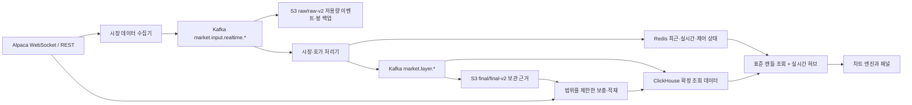

# 차트 데이터 아키텍처

Alpaca 데이터 유입부터 브라우저 차트 렌더링까지의 기준 문서입니다. 플랫폼별 키·테이블·토픽·접두사는 `platform/{kafka,redis,clickhouse,s3}/README.md`에 있습니다.

## 반드시 유지할 규칙

- 내부 데이터 구조를 바꿔도 표준 캔들 계약을 명시적으로 변경하는 작업이 아니라면 화면의 도형·좌표를 유지합니다. 정규장 장중 봉을 미국 동부시간 09:30에 맞추는 전환은 명시적인 계약 변경에 해당합니다.
- 프론트엔드는 REST·WebSocket 규약만 사용하며 Redis·ClickHouse·S3를 직접 읽지 않습니다.
- 과거 캔들은 `priceAdjustment=split`, `canonicalVersion=v2`인 경우에만 표준 데이터로 인정합니다. `split`은 주식 분할을 반영한 가격 보정입니다.
- S3 원본 영역은 저용량 이벤트·봉 백업만 보관합니다. 실시간 체결·호가는 제외하며 차트 조회나 ClickHouse 적재의 입력으로 사용하지 않습니다.
- 로컬 실행은 가짜 시장 캔들을 주입하지 않습니다. `?orderFlowDemo=1`은 브라우저 테스트 자료 경로일 뿐입니다.
- 실시간 미국 주식 데이터의 기준은 `1m`입니다. 저장된 `5m/10m/1h/4h`는 정규장 데이터를 `bucket_policy=us_equity_regular_session`으로 묶어 만듭니다. API·실시간 처리기는 보존된 장전·장후·야간 `1m`도 `bucket_policy=us_equity_extended_session`으로 집계합니다. 버킷(집계 구간)은 각 세션 시작에 맞추고 세션 경계를 넘지 않으며 실시간·과거 화면 모두에서 표시합니다.
- 범위를 제한한 과거 복구에서 `5m/10m`는 `1m`을 사용합니다. 정규장 `1h/4h`는 보통 Alpaca `10Min`을 `source_native` 복구 원본으로 사용합니다. 장외 세션을 가로지르면 `1Min`으로 전환하고 야간 구간은 BOATS로 보내 정규장·장외 봉을 함께 집계합니다. 시간봉 조회는 저장된 목표 주기 행, `10m`, 기존 `1m` 집계 순으로 사용하고 제한된 과거·실시간 장외 집계도 병합합니다.
- 집계 구간 시각은 UTC로 저장합니다. 개장·폐장·조기 폐장은 `America/New_York`의 NYSE 달력으로 판단합니다.
- BOATS 구독은 명시적인 실시간 종목 그룹으로 제한합니다. 열린 차트·관심종목·포트폴리오·순위·수동 종목이 `bars/updatedBars/trades/quotes`를 동적으로 구독하며 전체 종목의 야간 틱·봉을 무차별 분배하지 않습니다.
- 장중 데이터 범위는 최신 봉과 최신 정규장 봉을 함께 기록합니다. 더 새로운 장외 행이 있어도 최근 완료 NYSE 정규장 데이터가 오래됐으면 복구합니다. 현재 장전·장후·야간 끝부분도 복구하되 주말·휴일을 결측으로 취급하지 않습니다.
- 실행 경계에서 OHLCV(시가·고가·저가·종가·거래량)를 숫자로, `tradeCount`를 0 이상의 정수로 정규화합니다. Redis·ClickHouse의 기존 JSON 숫자 문자열은 실시간 집계 상태에 넣기 전에 변환하고 새 숫자 필드를 문자열로 저장하지 않습니다.
- 주문·KIS·에이전트 API는 이 데이터 처리 계약의 범위 밖입니다.

## 실행 흐름



Kafka 메시지 키를 종목으로 지정하는 `key=symbol`로 종목별 순서를 유지합니다. 미완료 실시간 봉과 체결·호가 표시는 Redis와 공통 `market.events` 발행·구독 채널을 사용합니다. 실시간 미완료 봉 전용 Kafka 토픽은 없습니다.

틱(개별 체결·호가 이벤트) 저장은 Kafka 경계에서 최소 한 번 전달을 허용하고 저장 경계에서는 멱등성을 적용합니다. 멱등성은 같은 작업을 반복해도 최종 결과가 중복되지 않는 성질입니다. 적재기는 HTTP 삽입까지 Kafka 메타데이터를 보존하고 `topic + partition + offset`에서 계산한 `insert_deduplication_token`을 전달합니다. 성공한 묶음에 포함된 오프셋만 커밋(처리 완료 위치 기록)합니다. 제한된 프로세스별 `sourceEventId` 캐시는 다른 묶음으로 재전달돼도 짧은 재생 중복을 거릅니다. 기존 비복제 MergeTree 테이블에는 운영 마이그레이션으로 삽입 중복 제거 범위를 활성화해야 합니다.

## 계산·저장 책임

| 데이터 | 계산 담당 | 실행 중 저장소 | 영구 저장소 | 부하를 결정하는 기준 |
| --- | --- | --- | --- | --- |
| 완료 봉 | 스트림 처리기 | Redis 최신 구간 | ClickHouse + S3 final | 시장 이벤트량 |
| 실시간 봉·체결·호가 | 스트림·호가 처리기 | 크기가 제한된 Redis 키 | ClickHouse 틱 | 전송량을 제한한 시장 이벤트 |
| 캔들 지표 | API 요청 | Redis 유효기간 캐시 | 없음 | 고유 요청 수 |
| 캔들 거래량 분포 | API 요청 | Redis 유효기간 캐시 | 없음 | 고유 요청 수 |
| 장중 분 단위 매수·매도 호가 | 스트림 처리기 | Redis 완료·현재 분 데이터 | ClickHouse 체결·호가 틱 | 체결 건수보다 저장 간격 |
| 일별 주문흐름 | 장 마감 집계 작업 | 없음 | `order_flow_profile_daily` | 하루 한 번의 제한된 묶음 |
| 종목 비교 | 표준 캔들 조회 API | 짧은 Redis 응답 캐시 | 원본 캔들만 저장 | 고유 요청 수 |

파생값은 재사용·복구·감사에 필요한 조회 주체가 있을 때만 저장합니다. 분 단위 주문흐름을 10분·1시간 열로 다시 묶는 등 표시 전용 집계는 프론트엔드 캐시에 두며 새로운 원본 데이터로 저장하지 않습니다.

## 증시지도 등락률 계약

LIVE의 `changePercent`는 최근 이용 가능한 가격을 직전 완료 정규장 종가와 비교합니다. ClickHouse가 기준을 `previousClose`로 반환하고, Redis에 더 새로운 실시간 가격이 있으면 API가 같은 기준으로 다시 계산합니다. 시가나 정적인 초기 종목 값으로 대체하지 않습니다.

직전 정규장 종가가 없으면 `previousClose`와 `changePercent`를 모두 `null`로 둡니다. 화면에는 대시를 표시하고 섹터·산업 평균 계산에서 제외하며 타일 색을 중립으로 유지합니다.

SIM도 같은 공식을 쓰며 고정 데이터셋의 직전 완료 정규장인 `2026-07-13` 종가를 기준으로 합니다. 시작 시 502개 종목의 `v2/split/regular` 종가를 한 번 읽고, 기준이 부족하면 시작을 거절합니다. 첫 재생 체결가나 시나리오 초기 등락률로 대체하지 않습니다.

## 캔들 조회 계약

단일 조회 경계는 프로젝트의 `CanonicalCandleQuery`입니다. 이 클래스는 여러 저장소의 데이터를 같은 표준 캔들 규약으로 제공하며 조회 순서를 통합합니다.

```text
Redis 최근·실시간 조회 데이터
  → ClickHouse의 같은 집계 정책 행 또는 제한된 표준 10m/1m 집계
  → 요청 범위에 대한 선택적 Alpaca 전경 보충
  → 백그라운드 S3 final/final-v2 적재
  → 백그라운드 Alpaca 과거 데이터 보충
```

전경 보충은 응답 전에 수행하고, 백그라운드 보충은 응답과 별도로 진행합니다. S3 객체는 요청한 종목·주기·반개구간(시작 포함, 끝 제외)에서 `matchedRowCount > 0`일 때만 적중으로 봅니다. v2 샤드 객체는 다른 종목의 충돌 행까지 한 감사 단위로 적재하지만, 그 행으로 현재 요청을 충족한 것으로 판단하지 않습니다. 여러 객체는 `symbol + interval + timestamp`로 중복을 제거한 뒤 한 번 삽입하며, 성공 후에만 객체 감사 기록을 남깁니다.

## 공개 차트 인터페이스

유지하는 경로는 다음과 같습니다.

```text
GET  /api/charts/candles
GET  /api/charts/compare
GET  /api/charts/events
GET  /api/charts/volume-profile-bins
GET  /api/charts/indicators
GET  /api/charts/order-flow/symbols
GET  /api/charts/order-flow/daily
GET  /api/charts/order-flow/intraday
POST /api/charts/active-symbol
WS   /ws/charts
```

### 뉴스·실적 마커

`GET /api/charts/events`는 ClickHouse만 읽으며 캔들 보충 흐름에 참여하지 않습니다. 요청 중 Yahoo·Alpaca·외부 뉴스 제공자를 호출하지 않습니다. 저장된 `news_company_daily_summaries`는 뉴욕 시장 날짜별 `N` 마커를, S&P 500 `yahoo_earnings_estimates`는 `E` 마커와 `upcomingDays` 안의 가장 가까운 예정 이벤트를 만듭니다.

차트 문서는 `events:earnings`, `events:news`를 레이어 설정으로 저장합니다. 이전 문서는 명시적으로 꺼둔 값이 없으면 둘 다 켭니다. 과거 봉을 추가할 때 새로 드러난 이벤트 범위만 요청하고, 뉴스 레이어가 보이는 동안 최신 뉴스 날짜를 60초마다 갱신합니다.

SIM에서는 `simulation_data_unavailable` 대신 `virtualTime`을 조회 기준으로 사용합니다. 일별 뉴스는 `argMax`로 최신 행을 고르기 전에 `generated_at <= virtualTime`을 적용해 재생 당시 존재하던 스냅샷만 선택합니다. `sourceAsOf`가 커서 이후인 실적도 제외합니다.

접근성을 위한 DOM 마커는 React 화면 갱신 전에 각 Canvas 장면 좌표와 동기화합니다. 변환 전 차트 컨테이너의 로컬 좌표로 바꾸므로 화면 배율·이동·줌 때문에 `E`·`N` 버튼과 봉이 분리되지 않습니다. 같은 봉의 이벤트는 x좌표를 유지하고 세로로 쌓습니다.

### 보유 평균가·체결 표시

모의계좌 평균 매입가 안내는 임시 프론트엔드 레이어이며 캔들이나 저장된 작도가 아닙니다. 인증된 계좌 스냅샷은 하나의 공용 계좌 WebSocket으로 현재 종목의 양수 수량과 평균가를 제공합니다. 가까운 평균가는 화면 가격 범위 계산에 참여할 수 있지만 캔들 원본·차트 문서·시장 API를 바꾸지 않습니다.

매수·매도 체결 마커도 인증된 임시 레이어입니다. LIVE에서는 완료된 모의주문만, SIM에서는 현재 `runId` 원장만 읽습니다. `B`는 대응 봉 저가 아래, `S`는 고가 위에 놓고 같은 봉의 체결은 같은 x중심에 세로로 쌓습니다. 일봉은 뉴욕 시장 날짜로, 장중·주봉·월봉은 체결 시각이 봉의 반개구간 안에 있는지로 대응합니다. 캔들·문서·작도·시장 저장소를 수정하지 않습니다.

### 실시간 구독과 파생 계산

`POST /api/charts/active-symbol`은 화면이 캔들 스냅샷을 요청하기 전에 선언한 `candles,trades,quotes` 레이어의 제한된 구독 그룹을 갱신합니다. 이를 통해 같은 요청이 제한된 REST 복구를 수행하는 동안 새 종목의 BOATS·SIP 수집을 시작합니다.

WebSocket 봉 이벤트는 `LIVE_CANDLE_UPDATE`, `CANDLE_CLOSED`, `CANDLE_CORRECTED`를 유지합니다. 주문흐름에는 `ORDER_FLOW_BINS_UPDATE`가 추가됩니다. 파생 응답의 최종 상태는 `derived.state=ready|failed`, 출처는 `derived.source=api-compute|redis`입니다. 별도 파생 대기열·작업자·ClickHouse 산출물 계약은 없습니다.

SIM에서도 `GET /api/charts/indicators`와 `GET /api/charts/volume-profile-bins`를 사용합니다. 재생 경계 이전의 표준 과거 봉과 현재 커서까지 완료된 재생 봉을 합친 뒤 LIVE와 같은 계산을 수행합니다. Redis 요청 식별에는 `datasetId + runId`를 포함하고 완료 봉 요청 범위로 커서를 구분해, 이전 실행이나 미래 LIVE 결과를 재사용하지 않습니다. MA5/20/60도 병합 후 다시 계산해 경계에서 이어지게 합니다. 장중 경계는 UTC 이벤트 시각, `1D` 경계는 뉴욕 시장 날짜를 사용합니다. 활성 시뮬레이터를 사용할 수 없으면 LIVE로 대체하지 않고 오류를 반환합니다.

### 화면 배율과 거래량 분포

화면 배율은 캔들 유무와 독립적입니다. 데이터 보충이 대기·실패·불가 상태여도 아직 로드하지 않은 슬롯까지 줌아웃할 수 있습니다. 페이지 조회와 백그라운드 보충은 슬롯을 채우기만 하며 반환 봉 수로 화면 범위를 되돌리지 않습니다. 가장 오래된 로드 봉이 화면에 들어오면 별도의 왼쪽 이동 없이 이전 범위를 요청합니다.

`GET /api/charts/volume-profile-bins`의 `targetBins`는 4~48개의 정확한 표시 구간 수입니다. 활성 차트는 실제 `scene.scales.minPrice/maxPrice` 범위를 같은 너비 10구간으로 나눠 요청합니다. 이 범위는 켜진 보조지표·보이는 매매 계획 제안·현재가·화면 여백을 포함하지만 일반 작도는 제외합니다.

가격축 눈금은 표시 범위를 늘리지 않습니다. 눈금 수는 가격 영역 높이로만 정하고 전체 범위를 같은 세로 간격으로 나눕니다. Bid/Ask는 개별 주문흐름 행을 유지하면서 같은 눈금 밀도 규약을 사용합니다.

요청은 보이는 완료 봉 수인 `candleCount`도 보내며, API는 이를 표준 조회 제한과 요청·캐시 식별에 포함합니다. 거래량 0인 구간도 반환해 가격상 빈 구간을 보존하지만 원본 봉이 없으면 빈 결과를 반환합니다. 응답의 `priceBinSize`는 결정된 가격 범위를 `targetBins`로 나눈 값이며 요청의 `priceBinSize=auto`와 호환됩니다. 캐시 키는 `volume-profile-exact-v2`입니다.

`candleCount`와 `sourceCandleCount`가 다르면 `dataStatus=partial`과 `requestedCandleCount`를 반환하고 Redis 파생 캐시에 쓰지 않습니다. `candleCount`를 생략한 요청은 기존 기본 봉 수를 사용합니다.

## 주문흐름을 사용하는 구성 요소

- `bidask` 차트는 장중 분 데이터를 읽고 `1m/10m/1h`로 표시합니다.
- `OrderFlowPanel`은 당일 Redis 분 데이터만 읽으며 종목·집계 범위·표시 해상도를 차트와 독립적으로 관리합니다.
- SIM의 같은 공개 API는 불변 `simulation_replay_events`에서 현재 `virtualTime`까지 종목별 제한된 조회 데이터를 만듭니다. LIVE Redis로 대체하지 않습니다. 다음 정규장 체결이 시작되기 전까지 마지막으로 재생한 정규장의 분포를 유지합니다.
- SIM 클라이언트는 필요한 1·10·60분을 `windowMinutes`로 보냅니다. 초기 조회는 그 구간과 호가 유효성 확인용 과거 범위만 읽습니다. `session` 선택 때만 같은 종목 캐시를 전체 세션으로 확장해 최초 표시에서 모든 과거 틱을 재구성하지 않습니다. 매수·매도 방향 분류 규약은 유지합니다.
- SIM 차트 소켓은 Bid/Ask·주문흐름 화면에서만 `orderFlow=true`를 보내 `ORDER_FLOW_BINS_UPDATE`, `LIVE_QUOTE_UPDATE`를 받습니다.
- 일별 행은 감사·기존 에이전트 차트 맥락용이며 Bid/Ask나 `OrderFlowPanel`의 입력이 아닙니다.
- 방향 분류는 주문흐름 API 메타데이터를 따릅니다. 캔들 거래량 분포는 봉 가격 범위에 거래량을 추정 배분하는 별도 기능입니다.

처리기 재시작 시 유효기간이 남은 Redis `live-minute`을 복구해 현재 분 집계를 이어가거나 완료 분으로 승격합니다. 긴 중단 구간은 장중 API가 복원하지 않습니다. 향후 복구 작업은 ClickHouse 체결·호가 틱으로 누락 분을 재생성하고 분별 `no-trades`와 `not-collected`를 구분해야 합니다. 그전에는 화면이 거래량 0인 행을 만들면 안 됩니다.

## S3 영속성

실시간 v2는 32개 종목 샤드와 결정적인 1분 객체를 사용합니다. 샤드는 데이터를 나누는 고정 그룹이며, 버퍼 식별은 `(partition path, UTC minute)`을 포함합니다. 정확한 재처리는 `HEAD`로 같은 다이제스트 키의 존재를 확인해 건너뜁니다. 다이제스트는 내용에서 계산한 식별용 해시입니다. 모든 S3 저장이 성공한 뒤에만 Kafka 오프셋을 커밋합니다. 두 저장 형식이 공존하는 전환 중에도 과거 v1 매니페스트(객체 목록·메타데이터)는 읽을 수 있습니다. 접두사는 `platform/s3/README.md`를 참고합니다.

## 상태 크기와 보존 범위

- Redis 최근 봉: 종목·주기별 120행
- Redis 실시간 키·주문흐름 분 데이터: 명시적 TTL(유효기간)
- 파생 캐시·잠금: 버전 키·짧은 TTL·원자적 Lua 소유자 확인
- ClickHouse 체결·호가 틱: TTL 21일
- ClickHouse 삽입 토큰: 테이블별 최근 삽입 블록 100,000개
- 적재기 원본 ID: Pod별 최근 테이블·이벤트 쌍 100,000개
- S3 raw/raw-v2: 운영자가 수명주기 관리, final 근거는 만료 없음
- 처리기 맵·비활성 차트 캔들 캐시·주문흐름 집계 캐시: 테스트된 상한 유지

### 저장된 차트 분석 자산

차트 분석 자산은 별도 사전 계산 작업의 결과이며 요청별 API 캐시가 아닙니다. 신규 생성·갱신은 `1m/1D`만 받습니다. 독립 생성기는 차트와 같은 완료 봉 경계를 사용해 Redis의 최신 완료 구간과 ClickHouse의 영구 이력을 읽고, 병합 전에 진행 중 봉을 제외합니다.

기존 `5m/10m/1h/4h/1W` 자산은 조회·명시적 삭제가 가능하지만 다시 생성하지 않습니다. 복구가 켜지면 요청한 누락 범위만 Alpaca에서 읽어 실제 표준 원본 행을 저장한 뒤 다시 조회합니다. 복구 적재는 S3·Kafka를 사용하지 않으며 ClickHouse에 실제 행만 씁니다. 로컬 테스트는 캔들 조회기를 주입하고 복구를 꺼 외부 호출·자격 증명이 필요하지 않습니다.

Alpaca가 거래가 없는 장중 구간의 봉을 생략하는 것은 정상일 수 있습니다. 요청 성공 후 실제 봉이 없으면 `provider_confirmed_empty`이며 OHLCV 행이나 수집 실패가 아닙니다. 인증·네트워크·호출 제한·서버 오류는 `alpaca_request_failed` 또는 사용 불가 상태로 남깁니다. 거래량 0인 봉이나 직전 값을 복사한 봉은 만들지 않습니다.

완료된 `1D/1W/1M`는 공용 `candleKey`를 사용합니다. 일봉 좌표는 뉴욕 시장 자정, 주봉·월봉 좌표는 UTC 집계 시작입니다. 조기 폐장을 포함한 마지막 실제 NYSE 세션 종료로 상위 주기 완료를 판단합니다. 조회·분석·최신성 점검·작도 기준점 맞춤이 모두 같은 식별을 사용합니다.

최근 NYSE 세션이 끝났는데 일봉이 없으면 일봉 조회 범위에 즉시 끝부분 결측을 보고합니다. 일반적인 달력 기준 3일 허용을 기다리지 않으며 주말·휴일·장 마감 전·표준 또는 설정된 조기 폐장은 잘못된 결측을 만들지 않습니다.

압축된 Geometry 자산만 PostgreSQL `chart_assets.geometry_assets`에 `(symbol, interval)`별 최신 JSONB 행 하나로 저장합니다. ClickHouse에 자산을 복제 저장하지 않습니다. ClickHouse는 표준 봉·선택적 복구 적재를 계속 담당하고, 생성 작업·항목·제한된 로그·상태 조회·종목/주기별 명시적 삭제는 PostgreSQL 계약입니다. 복구용 CronJob이나 완료 봉 구독은 없고 개발용 삭제 API는 보존 정책·자동 정리가 아닙니다. Geometry v6는 작도 8개·응답 256 KiB 제한 안에 있어 테이블·데이터 마이그레이션이 필요하지 않습니다.

분석 계산기는 표준 완료 종가 121개로 일봉 MA60/MA120 교차 이벤트를 만들 수 있습니다. 이는 자산 생성 기능이며 ClickHouse `ma120` 열·Redis 키·공개 캔들 필드를 추가하지 않습니다. 차트는 공용 파생 지표 API에서 `sma:120`을 요청할 수 있고, 표준 종가로 계산한 결과는 기존의 제한된 파생 캐시에만 둡니다.

## 유지 중인 호환 경로

일반 완료 봉 토픽·틱 분배 토픽·원본 매니페스트 조회는 외부 사용자가 없다는 근거가 아직 충분하지 않아 호환 계약으로 남깁니다. 신규 런타임이 이를 읽으려면 담당 주체를 문서화해야 합니다. 제거에는 브로커 소비자 그룹과 저장소 양쪽의 근거가 필요합니다.

운영·되돌리기 절차는 `CHART_DATA_OPERATIONS.md`에 있습니다.
