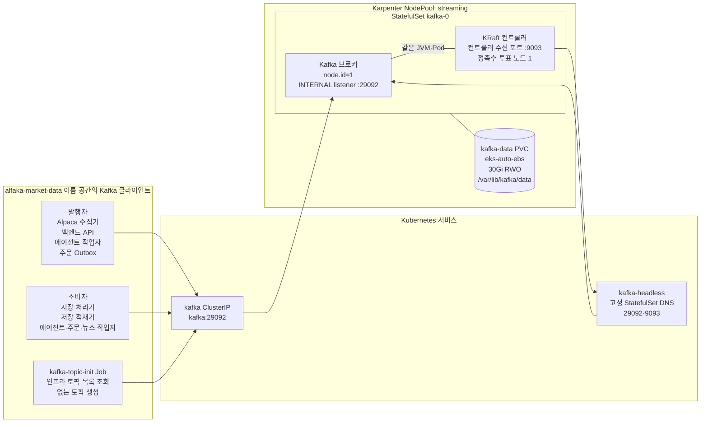
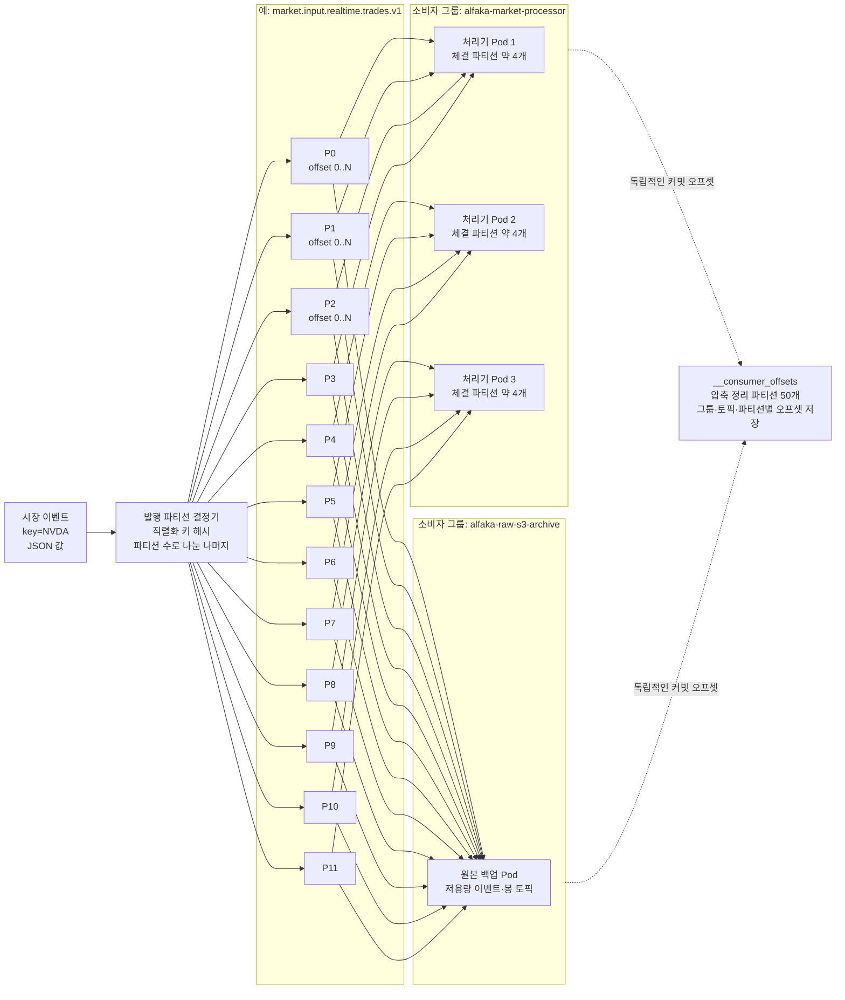
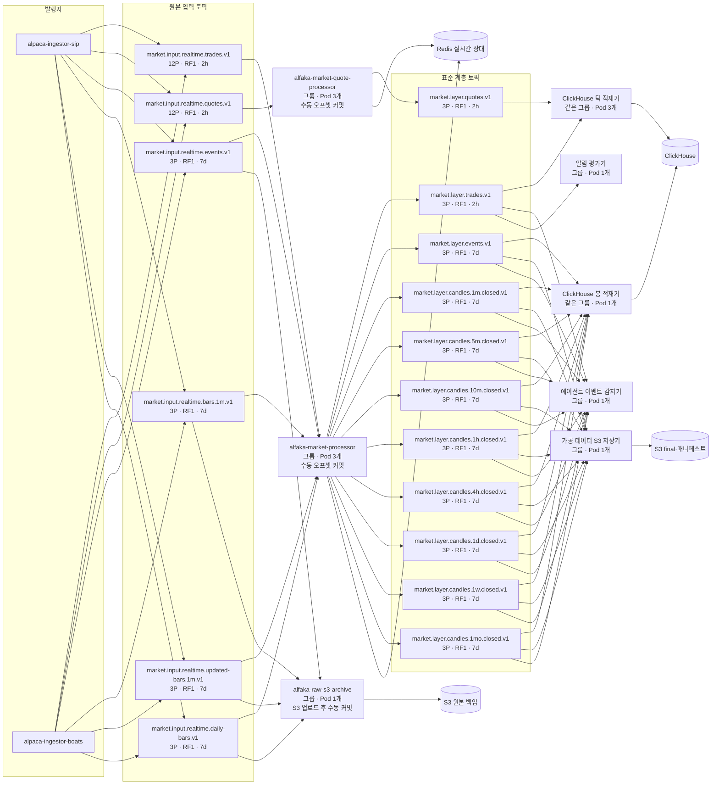
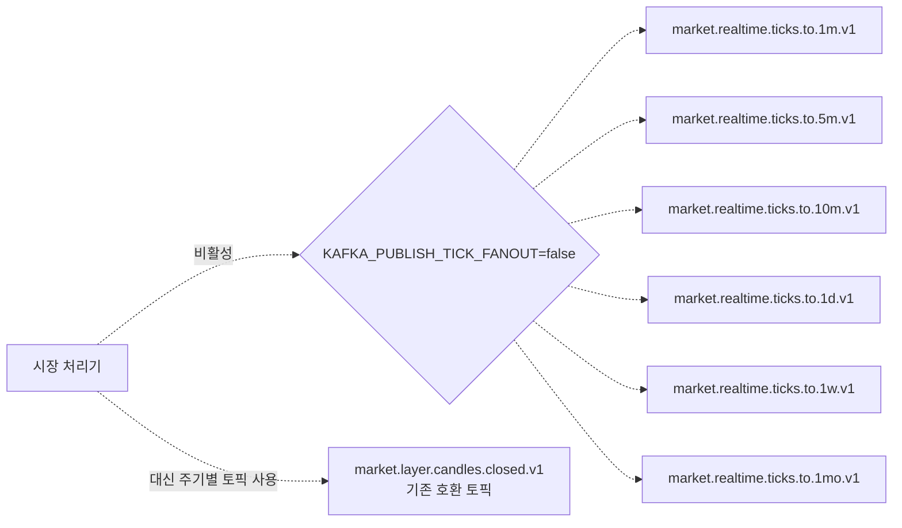
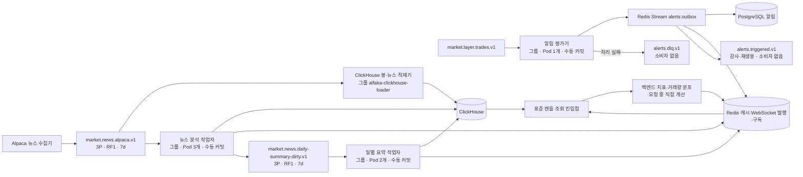
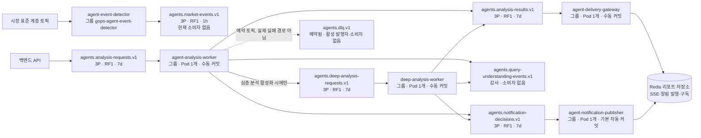
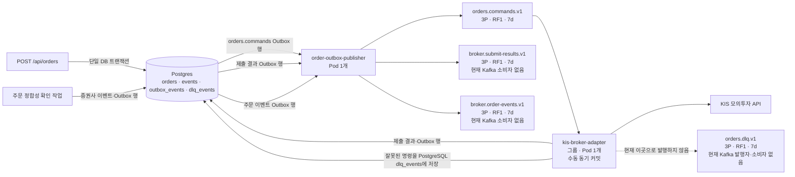

# GOPS Kafka 아키텍처

저장소의 현재 규약과 2026년 7월 10일 관측한 개발 EKS의 Kafka 구성을 설명합니다. Kafka는 메시지를 토픽별로 저장하고 여러 작업자에게 전달하는 이벤트 스트림 시스템입니다. 저장소는 애플리케이션 토픽 39개와 내부 `__consumer_offsets`를 정의합니다. 초기화는 없는 토픽을 생성할 뿐 삭제하지 않으므로 배포 후 실제 브로커 목록을 비교해야 합니다. 브로커에 남아 있는 과거 토픽이 모두 현재 사용 중인 것은 아닙니다.

이 문서의 구성·복제 수는 위 관측 시점 기준이며 현재 운영 중임을 뜻하지 않습니다. 브로커는 메시지를 보관·전달하는 서버이고, 파티션은 토픽을 순서 보장과 병렬 처리 단위로 나눈 조각입니다.

## 물리 구성



| 설정 | 관측값 |
| --- | --- |
| Kafka 이미지 | `apache/kafka:3.9.0` |
| 메타데이터 모드 | KRaft, ZooKeeper 미사용 |
| 브로커 수 | 1 |
| 컨트롤러 수 | 1개, 브로커와 같은 프로세스 |
| 복제 계수 | 모든 앱·내부 토픽에서 1 |
| 최소 동기화 복제본 수 | 1 |
| 네트워크 | 이름 공간 내부 `PLAINTEXT` |
| 토픽 자동 생성 | 활성화 |
| 기본 파티션 수 | 3 |
| 기본 보존 기간 | 168시간, 7일 |
| 기본 세그먼트 크기 | 1 GiB |
| 발행 응답 확인 | `acks=1` |
| JVM heap | `-Xms1g -Xmx2g` |
| Pod 자원 | 요청 `1 CPU / 3Gi`, 상한 `2 CPU / 4Gi` |
| 영구 저장소 | EBS PVC `30Gi`, `/var/lib/kafka/data`에 연결 |

브로커·컨트롤러·모든 리더 파티션과 복제본이 `kafka-0`에 있습니다. PVC(컨테이너 교체 후에도 남는 저장 공간)는 Pod 교체 때 로그를 보존하지만 브로커 장애에도 계속 서비스하는 고가용성을 제공하지는 않습니다. `kafka-0`이 중단되면 모든 발행자·소비자가 같은 브로커의 복구를 기다립니다.

## 파티션·순서·오프셋 모델



- Kafka는 토픽 전체가 아니라 파티션 안에서 순서를 보장합니다.
- 시장 데이터 발행자는 모두 `key=symbol`을 사용합니다. 파티션 수가 같으면 직렬화된 같은 종목 키는 같은 파티션으로 갑니다.
- 소비자 그룹은 같은 일을 나눠 처리하는 작업자 집합입니다. 그룹 안에서 파티션 하나는 최대 한 활성 소비자에게 배정되고, 다른 그룹은 같은 파티션을 독립적으로 읽습니다.
- 체결·호가 입력 토픽은 파티션이 12개이므로 그룹별 활성 소비자도 최대 12개입니다. 현재 처리기 복제본 3개는 보통 각각 약 4개를 받습니다.
- 파티션 3개인 일반 토픽은 그룹당 최대 3개 소비자가 처리합니다. 복제본을 더 늘려도 해당 토픽에서는 대기합니다.
- 오프셋은 파티션 안의 메시지 위치입니다. 커밋은 그룹별 처리 완료 위치를 기록해 재시작 지점을 정하는 작업입니다.

## 시장 데이터 처리 흐름



다음 시장 토픽은 존재하지만 현재 실시간 핵심 처리 경로에서는 사용하지 않습니다.



실시간 차트 상태는 Redis와 `market.events` 발행·구독 채널을 사용하며, 미완료 실시간 봉 전용 Kafka 토픽은 없습니다. 가공 데이터 S3 저장기는 주기별 완료 봉·이벤트만 저장합니다. 체결·호가는 틱 적재기가 ClickHouse에 넣고 원본 S3 백업에서는 의도적으로 제외합니다.

## 뉴스·API 파생 데이터·알림



## 에이전트 토픽



빠른 분석·심층 분석 작업자는 같은 프로세스 안에서 프로젝트의 `AgentOrchestrator`를 실행합니다. 이 구성 요소는 분석 흐름을 조율합니다. 독립 HTTP 서비스인 `agent-orchestrator`도 호환 요청의 결과·알림 결정을 발행할 수 있습니다. 잘못되거나 실패한 비동기 분석은 현재 `agents.analysis-results.v1`의 실패 리포트로 표현합니다. `agents.dlq.v1`은 존재하지만 실제 실패 전달 경로는 아닙니다. DLQ는 정상 처리하지 못한 메시지를 따로 보관하는 통로입니다.

## 주문 토픽



## 전체 토픽 목록

모든 애플리케이션 토픽의 복제 계수는 1입니다. 아래 `7d`는 토픽별 덮어쓰기 설정 없이 브로커 기본값 `log.retention.hours=168`을 적용한다는 뜻입니다. 그림의 `P`는 파티션 수, `RF`는 복제 계수, `h/d`는 시간/일 단위 보존 기간입니다.

| 번호 | 토픽 | 파티션 수 | 보존 | 발행자 | 현재 소비자 그룹 |
| ---: | --- | ---: | ---: | --- | --- |
| 1 | `market.input.realtime.trades.v1` | 12 | 2h | Alpaca 수집기 | `alfaka-market-processor` |
| 2 | `market.input.realtime.quotes.v1` | 12 | 2h | Alpaca 수집기 | `alfaka-market-quote-processor` |
| 3 | `market.input.realtime.events.v1` | 3 | 7d | Alpaca 수집기 | `alfaka-market-processor`, `alfaka-raw-s3-archive` |
| 4 | `market.input.realtime.bars.1m.v1` | 3 | 7d | Alpaca 수집기 | `alfaka-market-processor`, `alfaka-raw-s3-archive` |
| 5 | `market.input.realtime.updated-bars.1m.v1` | 3 | 7d | Alpaca 수집기 | `alfaka-market-processor`, `alfaka-raw-s3-archive` |
| 6 | `market.input.realtime.daily-bars.v1` | 3 | 7d | Alpaca 수집기 | `alfaka-market-processor`, `alfaka-raw-s3-archive` |
| 7 | `market.realtime.ticks.to.1m.v1` | 3 | 7d | 처리기 분배 비활성 | 없음 |
| 8 | `market.realtime.ticks.to.5m.v1` | 3 | 7d | 처리기 분배 비활성 | 없음 |
| 9 | `market.realtime.ticks.to.10m.v1` | 3 | 7d | 처리기 분배 비활성 | 없음 |
| 10 | `market.realtime.ticks.to.1d.v1` | 3 | 7d | 처리기 분배 비활성 | 없음 |
| 11 | `market.realtime.ticks.to.1w.v1` | 3 | 7d | 처리기 분배 비활성 | 없음 |
| 12 | `market.realtime.ticks.to.1mo.v1` | 3 | 7d | 처리기 분배 비활성 | 없음 |
| 13 | `market.layer.candles.closed.v1` | 3 | 7d | 기존 호환 | 없음 |
| 14 | `market.layer.candles.1m.closed.v1` | 3 | 7d | 시장 처리기 | ClickHouse, 가공 S3, 이벤트 감지기 |
| 15 | `market.layer.candles.5m.closed.v1` | 3 | 7d | 시장 처리기 | ClickHouse, 가공 S3, 이벤트 감지기 |
| 16 | `market.layer.candles.10m.closed.v1` | 3 | 7d | 시장 처리기 | ClickHouse, 가공 S3, 이벤트 감지기 |
| 17 | `market.layer.candles.1h.closed.v1` | 3 | 7d | 시장 처리기 | ClickHouse, 가공 S3, 이벤트 감지기 |
| 18 | `market.layer.candles.4h.closed.v1` | 3 | 7d | 시장 처리기 | ClickHouse, 가공 S3, 이벤트 감지기 |
| 19 | `market.layer.candles.1d.closed.v1` | 3 | 7d | 시장 처리기 | ClickHouse, 가공 S3, 이벤트 감지기 |
| 20 | `market.layer.candles.1w.closed.v1` | 3 | 7d | 시장 처리기 | ClickHouse, 가공 S3, 이벤트 감지기 |
| 21 | `market.layer.candles.1mo.closed.v1` | 3 | 7d | 시장 처리기 | ClickHouse, 가공 S3, 이벤트 감지기 |
| 22 | `market.layer.trades.v1` | 3 | 2h | 시장 처리기 | ClickHouse 틱 적재기, 이벤트 감지기, 알림 평가기 |
| 23 | `market.layer.quotes.v1` | 3 | 2h | 호가 처리기 | ClickHouse 틱 적재기 |
| 24 | `market.layer.events.v1` | 3 | 7d | 시장 처리기 | ClickHouse, 가공 S3, 이벤트 감지기 |
| 25 | `market.news.alpaca.v1` | 3 | 7d | 뉴스 수집기·최근 데이터 보충 | ClickHouse 적재기, 뉴스 분석 |
| 26 | `market.news.daily-summary-dirty.v1` | 3 | 7d | 뉴스 분석 | 뉴스 일별 요약 작업자 |
| 27 | `orders.commands.v1` | 3 | 7d | 주문 Outbox 발행기 | `kis-broker-adapter` |
| 28 | `broker.submit-results.v1` | 3 | 7d | 주문 Outbox 발행기 | 없음 |
| 29 | `broker.order-events.v1` | 3 | 7d | 주문 Outbox 발행기 | 없음 |
| 30 | `orders.dlq.v1` | 3 | 7d | 예약됨; 실제 DLQ는 PostgreSQL | 없음 |
| 31 | `alerts.triggered.v1` | 3 | 7d | 알림 평가기 outbox sender | 없음; 감사·재생 토픽 |
| 32 | `alerts.dlq.v1` | 3 | 7d | 알림 평가기 | 없음 |
| 33 | `agents.market-events.v1` | 3 | 1h | 에이전트 이벤트 감지기 | 없음 |
| 34 | `agents.analysis-requests.v1` | 3 | 7d | 백엔드 API | `gops-agent-analysis-worker` |
| 35 | `agents.deep-analysis-requests.v1` | 3 | 7d | 활성화된 분석 작업자 | `gops-agent-deep-analysis-worker` |
| 36 | `agents.analysis-results.v1` | 3 | 7d | 분석·심층 작업자 또는 오케스트레이터 | `gops-agent-delivery-gateway` |
| 37 | `agents.query-understanding-events.v1` | 3 | 7d | 분석·심층 작업자 또는 오케스트레이터 | 없음; 감사 토픽 |
| 38 | `agents.notification-decisions.v1` | 3 | 7d | 분석·심층 작업자 또는 오케스트레이터 | `gops-agent-notification-publisher` |
| 39 | `agents.dlq.v1` | 3 | 7d | 예약됨 | 없음 |

내부 토픽:

| 토픽 | 파티션 수 | 복제 수 | 정리 정책 | 용도 |
| --- | ---: | ---: | --- | --- |
| `__consumer_offsets` | 50 | 1 | 키별 압축 정리 | 소비자 그룹·토픽·파티션별 커밋 오프셋 |

## 소비자 그룹과 커밋 정책

| 소비자 그룹 | Pod 수 | 입력 토픽 | 커밋 정책 |
| --- | ---: | --- | --- |
| `alfaka-market-processor` | 3 | 체결·봉·수정 봉·일봉·이벤트 원본 토픽 | 수동 |
| `alfaka-market-quote-processor` | 3 | 원본 호가 | 수동 |
| `alfaka-raw-s3-archive` | 1 | 원본 이벤트·1분봉·수정 봉·일봉 | 모든 S3 저장 성공 후 수동 |
| `alfaka-processed-s3-sink` | 1 | 완료 봉 토픽 8개·표준 계층 이벤트 | S3 버퍼 저장 후 수동 |
| `alfaka-clickhouse-loader` | 구성원 4개 | 봉·뉴스 적재기 1개와 체결·호가 적재기 3개 | ClickHouse 삽입 후 수동 |
| `alfaka-news-intelligence-worker` | 3 | Alpaca 뉴스 | Redis·ClickHouse 반영 후 수동 |
| `alfaka-news-daily-summary-worker` | 2 | 일별 요약 갱신 요청 | Redis·ClickHouse 반영 후 수동 |
| `gops-agent-event-detector` | 1 | 체결·완료 봉 토픽 8개·이벤트 | 기본 자동 커밋 |
| `gops-alert-evaluator` | 1 | 표준 계층 체결 | 체결 평가 후 수동 |
| `gops-agent-analysis-worker` | 1 | 분석 요청 | 리포트 처리 후 수동 |
| `gops-agent-deep-analysis-worker` | 1 | 심층 분석 요청 | 리포트 처리 후 수동 |
| `gops-agent-delivery-gateway` | 1 | 분석 결과 | Redis 전달 후 수동 |
| `gops-agent-notification-publisher` | 1 | 알림 결정 | 기본 자동 커밋 |
| `kis-broker-adapter` | 1 | 주문 명령 | 어댑터 처리 후 수동 동기 커밋 |

원본·가공 S3 저장기는 자동 커밋을 명시적으로 끕니다. 버퍼의 모든 S3 저장을 완료한 뒤 처리 위치를 커밋하며, 업로드 실패 시 재처리할 수 있도록 오프셋을 남깁니다. ClickHouse 적재기도 실제 저장이 성공한 다음 커밋합니다.

## 토픽별 보존 설정

| 토픽 | 보존 기간 | 세그먼트 시간 | 세그먼트 크기 |
| --- | ---: | ---: | ---: |
| `agents.market-events.v1` | 1시간 | 10분 | 128 MiB |
| `market.input.realtime.trades.v1` | 2시간 | 15분 | 256 MiB |
| `market.input.realtime.quotes.v1` | 2시간 | 15분 | 256 MiB |
| `market.layer.trades.v1` | 2시간 | 15분 | 256 MiB |
| `market.layer.quotes.v1` | 2시간 | 15분 | 256 MiB |
| 나머지 모든 앱 토픽 | 7일 | 브로커 기본값 | 브로커 기본값 1 GiB |

Kafka는 쓰기가 끝난 로그 세그먼트 단위로 데이터를 지웁니다. 짧게 보존하는 토픽은 `segment.ms`와 `segment.bytes`를 함께 지정합니다. `retention.ms`만 설정하면 아직 쓰는 기본 세그먼트가 목표 보존 기간을 넘겨 남을 수 있습니다.

## 저장소와 브로커 구성 대조

기준 토픽 목록은 `platform/kafka/topics.txt`입니다. Kubernetes 복사본과 바이트 단위로 같은지 검사하고 로컬 생성도 기준 파일을 읽습니다. 초기화 Job은 없는 토픽을 만들되 브로커 상태를 삭제하지 않습니다. 계약 변경을 배포한 뒤 운영자가 실제 토픽·소비자 그룹을 이 문서와 비교하고, 참조하지 않는 토픽은 별도 절차로 정리합니다.

## 점검 명령

```bash
kubectl exec -n alfaka-market-data kafka-0 -- \
  /opt/kafka/bin/kafka-topics.sh --bootstrap-server localhost:29092 --describe

kubectl exec -n alfaka-market-data kafka-0 -- \
  /opt/kafka/bin/kafka-consumer-groups.sh --bootstrap-server localhost:29092 --list

kubectl exec -n alfaka-market-data kafka-0 -- \
  /opt/kafka/bin/kafka-consumer-groups.sh --bootstrap-server localhost:29092 \
  --describe --all-groups
```
