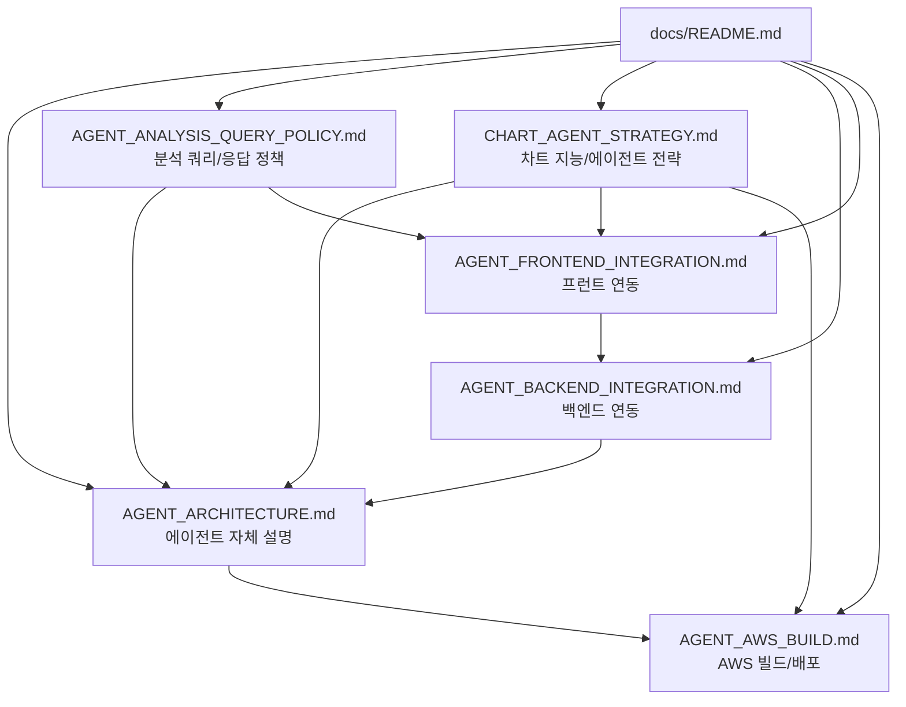

# GOPS 문서 안내

프로젝트 구조·설계·연동·운영 문서의 색인입니다. 루트 `README.md`는 포트폴리오 소개를, 루트 `AGENTS.md`는 기여자 작업 규칙을 담고 있습니다. 상세 설계는 이 폴더에서 확인합니다.

| 파일 | 용도 |
| --- | --- |
| `REPOSITORY_REFERENCE.md` | 저장소 구조, API 규약, 운영 규칙과 검증 명령. |
| `PRODUCT_CONTEXT.md` | 제품 방향과 현재 구현·향후 계획의 경계. |
| `CHART_DATA_ARCHITECTURE.md` | 차트 원본 데이터 책임, 계산 위치, 조회 경로, API·WebSocket·주문흐름·S3 규약. |
| `CHART_AGENT_STRATEGY.md` | 차트 지능의 투자적 역할, 결정론적 계산기, 규칙·언어모델 경계, 작도 변환기, 데이터 사전 계산, 실행 조율기 통합, 단계별 구현 전략. |
| `CHART_ANALYSIS_ASSETS.md` | 현재 작도 제안 로직, 품질 기준, LLM 경계, 저장·화면 흐름을 Mermaid 중심으로 설명하는 사람용 문서. |
| `CHART_ANALYSIS_ASSETS_CODEX.md` | 이후 Codex 변경을 위한 불변 조건, 파일 책임, 임계값·내용 해시, 검증 절차 기술 기준서. |
| `CHART_DATA_OPERATIONS.md` | 검증·배포 관찰·복구·보존·Terraform 관리 범위·되돌리기 절차. |
| `STRUCTURE_GUIDE.md` | 새 코드를 배치할 폴더 규칙. |
| `ARCHITECTURE.md` | 시스템·Pod·Job·플랫폼의 현재 관계. |
| `IMAGE_STRATEGY.md` | Docker 이미지의 담당 범위와 이름 규칙. |
| `ENVIRONMENT.md` | 환경 변수·비밀값·플랫폼 규약. |
| `KAFKA_ARCHITECTURE.md` | EKS Kafka의 브로커·파티션·토픽·발행자·소비자 그룹·오프셋·보존 구성. |
| `LOCAL_EKS_DEPLOY.md` | 원격 origin/dev를 공용 개발 EKS에 로컬 명령 하나로 배포하는 절차. |
| `EKS_DATA_PRESERVING_REBUILD_PLAN.md` | 데이터를 보존하면서 전용 노드 풀과 복원 PVC로 EKS를 재구성하는 절차. |
| `AGENT_ORCHESTRATION_IMPLEMENTATION.md` | 역할별 다중 에이전트 구현과 Docker 검증 요약. |
| `STOCK_RECOMMENDATION_PANEL.md` | 장중 매수 추천 패널의 현재 구현, 확인된 품질 위험, API/DB/worker/프런트 계약, 개선 목표. |
| `PROFESSIONAL_PERSONALIZED_RECOMMENDATION_LOGIC.md` | v1/V2와 결정론적 evidence V3, 한국어 설명·신뢰도 계약을 구분한 상세 문서. |
| `AWS_RECOMMENDATION_DATA_PREPARATION.md` | 관측 시각이 기록된 AWS 상태, SPY·V3 활성화 조건, 추천 데이터 복구·검증 순서를 정리한 운영 절차. |
| `AGENT_ARCHITECTURE.md` | 분석 조율기 `AgentOrchestrator`, 역할별 에이전트, 스냅샷, 결과 종합, 데이터 제공자 경계와 `EvidenceItem` 규약. |
| `AGENT_ANALYSIS_QUERY_POLICY.md` | 우선 처리할 분석 쿼리 종류, 결론 중심 답변 형식, 신뢰도 표시, 내부 GraphDB 사용 정책. |
| `AGENT_BACKEND_INTEGRATION.md` | 백엔드 API, 멱등성, Kafka 비동기 경로, Redis 리포트 저장소, 반복 조회·SSE·WebSocket 규약. |
| `AGENT_FRONTEND_INTEGRATION.md` | 프런트 요청 형식, `analysisId`, 반복 조회·SSE, 리포트 표시, 화면 배치·차트 제안 처리. |
| `AGENT_AWS_BUILD.md` | `gops-agent-orchestrator` 이미지, ECR·EKS, Kafka, Redis·Valkey, ClickHouse, GraphDB, S3, 비밀값과 기본 동작 점검. |
| `../systems/fundamentals/README.md` | 기업 비교에서 쓰는 SEC 재무정보·Yahoo 추정치·10-K 기업 소개의 일괄 처리·저장 규약. |
| `ai-coach/CODEX_TASK_PROMPT.md` | 이 작업에 사용한 AI 투자 코치 1페이지 구현·검증 원문 프롬프트. |
| `ai-coach/HANDOFF.md` | AI 투자 코치 4페이지 계약, 결정론적 계산, 입력 스냅샷, AWS 흐름 및 외부 데이터 의존성. |
| `../AGENTS.md` | 이 저장소의 Codex·기여자 작업 규칙. |

보조 문서로 `ALERT_SYSTEM_DESIGN.md`, `ODC.md`, `ONBOARDING_LOCAL_DOCKER.md`, `about_front.md`, `cdc.md`가 있습니다. 특정 하위 시스템을 설명하며 위 기준 문서를 대체하지 않습니다.

`docs/v2/`는 과거 팀 기획 자료입니다. 해당 폴더 README에서 현재 기준이 아님을 명시합니다. 내용이 충돌하면 현재 코드·`AGENTS.md`·이 색인·위 기준 문서를 우선합니다. 색인에 없는 장문의 과거 문서를 현재 계약으로 오해하지 않도록 합니다.

차트 데이터 작업은 `CHART_DATA_ARCHITECTURE.md`부터 읽고 관련 플랫폼 README와 현재 코드를 확인합니다. 고정 과거 데이터 사전 적재·전체 종목 틱/호가 수집·원본 S3 적재·폐기된 파생 대기열을 되살리지 않습니다.
