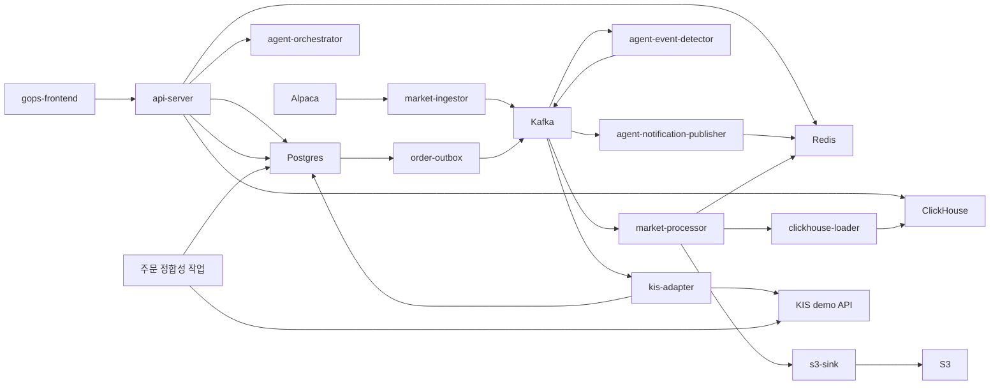

# GOPS 저장소 기술 참고

[포트폴리오 README로 돌아가기](../README.md)

API 계약·운영 규칙·검사 명령을 모은 개발 참고 자료입니다. 경로와 명령은 저장소 루트를 기준으로 합니다.
기존 배포 서비스와 외부 API 이용 환경은 종료되었으며, 아래 명령의 실행에는 별도 환경 구성이 필요합니다.

## 저장소 구조

```text
apps/gops-frontend/                React 프론트엔드
apps/chart-engine/                 차트 문서·런타임·캔버스 엔진

systems/api-server/                FastAPI 차트·주문·WebSocket 게이트웨이
systems/market-data/               설정, 수집, 처리, 저장, 조회 도우미, 필요 시 데이터 보충
systems/order/                     KIS 모의투자 주문 도메인, Outbox, 어댑터, 작업
systems/agent-orchestration/       역할별 에이전트, 이벤트 감지기, 알림 발행기

platform/kafka/topics.txt          시장·주문 Kafka 토픽 계약
platform/*/README.md               로컬 -> Pod -> 관리형 서비스 전환 설명

infra/docker/                      Dockerfile 모음
infra/k8s/                         Kubernetes 기본 구성과 AWS 오버레이
infra/aws/terraform/               ECR·S3·Secrets·IRSA 기반 구성
infra/clickhouse/initdb/           로컬 ClickHouse 스키마

scripts/local/                     로컬 스모크 검사·점검 스크립트
scripts/aws/                       AWS 이미지·토픽·적용 도우미
shared/chart-contract/             시스템 간 차트 명령 계약 설명
docs/                              프로젝트 참고 문서
```

## 런타임 흐름



## API 계약

차트 API:

```text
GET  /api/charts/candles
GET  /api/charts/symbols
WS   /ws/charts
```

사용 중단된 차트 백필 큐 경로는 `410 Gone`을 반환한다. `GET /api/charts/candles`는
차트를 조회하고 누락 데이터를 보충하는 단일 진입점이며, 데이터가 없거나 일부만 채워진
경우 응답에 `fill` 추적 정보를 포함한다.

에이전트 API:

```text
POST /api/agents/analyze
GET  /api/agents/reports/{analysis_id}
GET  /api/agents/reports/{analysis_id}/stream
WS   /ws/agent-alerts
```

주문 API:

```text
GET  /api/order-contract
GET  /api/orders/balance
POST /api/orders
GET  /api/orders/{order_id}
GET  /api/orders/{order_id}/events
WS   /ws/orders/{order_id}
```

주문 규칙:

- `POST /api/orders`는 `Idempotency-Key` 헤더가 반드시 필요하다.
- `GET /api/orders/balance`는 선택한 종목과 거래소를 기준으로 KIS 모의투자 해외주식 주문 가능 금액을 조회한다.
- v1에서는 `KIS_ENV=real`을 사용할 수 없다.
- v1 주문 제출은 KIS 해외주식 모의투자 지정가 주문만 지원한다.
- KIS 모의투자 자격 증명은 기본적으로 AWS Secrets Manager의 `tead/gops/kis`에서 읽는다.

인증 규칙:

- `AUTH_ENABLED=true`로 설정하면 `/api/orders`, `/ws/orders/{order_id}`, `/api/llm/*`에서 Google 로그인을 요구한다.
- v1에서 차트와 시장 데이터 API는 공개 상태를 유지한다.
- 세션은 Redis에 저장되며 `AUTH_REDIS_KEY_PREFIX`로 범위를 분리한다.
- Google OAuth 환경 변수를 먼저 직접 읽고, 값이 비어 있으면 `GOOGLE_OAUTH_SECRET_NAME`에 지정한 AWS Secrets Manager 비밀값에서 읽는다.

## 운영 규칙

- 차트 API는 S3를 직접 읽지 않고 Redis와 ClickHouse에서 응답한다.
- S3는 재생과 재구성을 위한 영구 저장소다.
- ClickHouse의 `chart_candles`가 조회용 프로젝션이다.
- 로컬 런타임은 가짜 시장 캔들을 만들면 안 된다.
- 에이전트 오케스트레이션은 주문을 실행하거나 계좌 제어 흐름을 호출하면 안 된다.
- 에이전트 제공자 호출이 실패하면 전체 분석을 중단하지 않고 데이터 없음 근거로 안전하게 축소해야 한다.
- `.env`, 액세스 키 CSV, KIS 토큰 캐시, `node_modules`, `dist`, 로컬 캐시는 커밋하면 안 된다.

## 검증

변경 사항을 공유하기 전에 관련 검사를 실행한다.

```sh
PYTHONPATH=systems/market-data/shared:systems/order/shared:systems/order:systems/api-server/pods/api-server/gops-backend python -m compileall -q systems
PYTHONPATH=systems/market-data/shared:systems/order/shared:systems/order:systems/api-server/pods/api-server/gops-backend python -m unittest discover systems/market-data/tests
PYTHONPATH=systems/market-data/shared:systems/order/shared:systems/order:systems/api-server/pods/api-server/gops-backend python -m unittest discover systems/api-server/tests
PYTHONPATH=systems/market-data/shared:systems/order/shared:systems/order:systems/api-server/pods/api-server/gops-backend python -m pytest systems/order/tests/kis_trader
npm run test:chart --prefix apps/gops-frontend
npm run build --prefix apps/gops-frontend
docker compose config --quiet
kubectl kustomize infra/k8s/base >/tmp/gops-k8s-base.yaml
kubectl kustomize infra/k8s/overlays/aws >/tmp/gops-k8s-aws.yaml
git diff --check
```

실행 중인 서비스의 스모크 검사:

```sh
curl -fsS http://localhost:8000/health
curl -fsS http://localhost:8000/api/charts/symbols
curl -fsS 'http://localhost:8000/api/charts/candles?symbol=NVDA&interval=1m&limit=2'
curl -fsS http://localhost:8000/api/order-contract
curl -fsS 'http://localhost:8000/api/orders/balance?symbol=NVDA&exchange=NASD&price=1.00'
```
